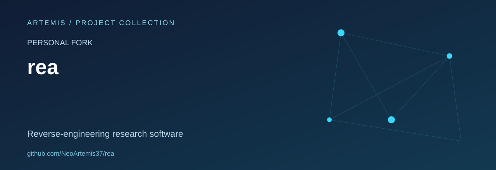

# REA

**Personal study fork of [morluto/rea](https://github.com/morluto/rea).**

REA is an upstream software-analysis project that exposes reverse-engineering capabilities through MCP. This repository is retained as an evaluation workspace for studying its architecture, integration boundaries and documentation.

The original project and its maintainers are credited below. This overview does not claim an independent release, a tested deployment or an upstream contribution by Artemis.

## Repository map

| Area | Purpose in the inspected tree |
| --- | --- |
| `src/` | Application and MCP implementation |
| `bridge/` | Integrations with analysis tools |
| `native/` | Native components |
| `docs/` | Existing project documentation |
| `tests/` | Upstream test material |
| `third_party/` | Third-party components |

## Study scope

The focus of this fork overview is software architecture and analysis of operator-owned applications and laboratory artifacts. It does not add deployment, exploitation or autonomous analysis workflows.

A directory named `tests` or an upstream CI badge is not evidence that this fork has been tested. Execution and compatibility have not been validated as part of this documentation refresh.

## Attribution

- Upstream repository: [morluto/rea](https://github.com/morluto/rea).
- Copyright: the original project authors, including morluto, as recorded in the source files and [LICENSE](LICENSE).
- License: MIT, as declared in the inspected root license.

Fork-specific implementation changes should be documented separately from upstream features.
